# Hermes Mini

A mobile-first chat app for your own [Hermes](https://hermes-agent.nousresearch.com/) agent.

Hermes Mini is a single Hermes plugin that serves a fast, installable web app for talking to your
agent from a phone, tablet or desktop: multiple chats, an inbox, to-dos, live progress lines,
steering, optional push notifications, dictation, and an optional bundled view of your agent's
desktop.

- **Product name**: Hermes Mini (the install name and the app's own label; the browser tab shows the
  agent's name).
- **Agent name**: the name your Hermes bot already has — the default profile's bot title first, then
  the serving profile's — with **Hermes** as the fallback when none is set.
- **One plugin**: settings and state live outside the plugin, so updating the code never touches them.

## Screenshots

Screenshots use sample data.

<p>
<a href="docs/media/demo.mp4">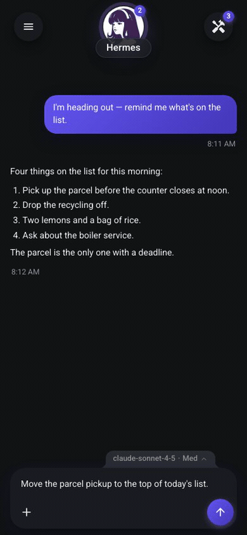</a>
<a href="docs/media/demo-walkthrough.mp4">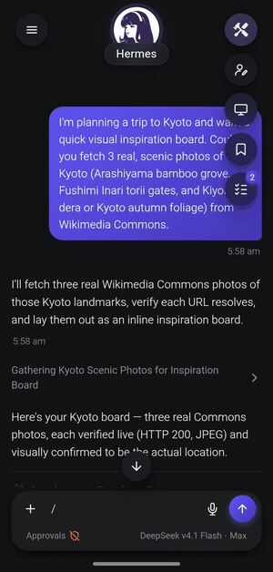</a>
</p>

<p>
<a href="docs/media/phone-01-chat.png">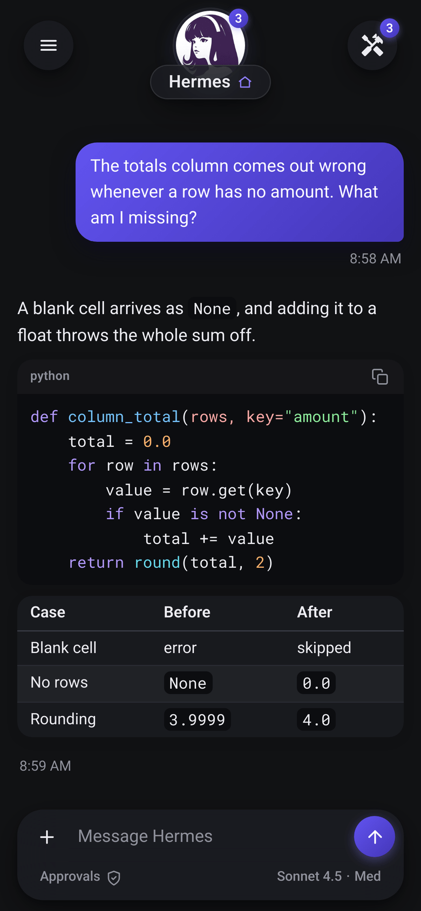</a>
<a href="docs/media/phone-02-working.png">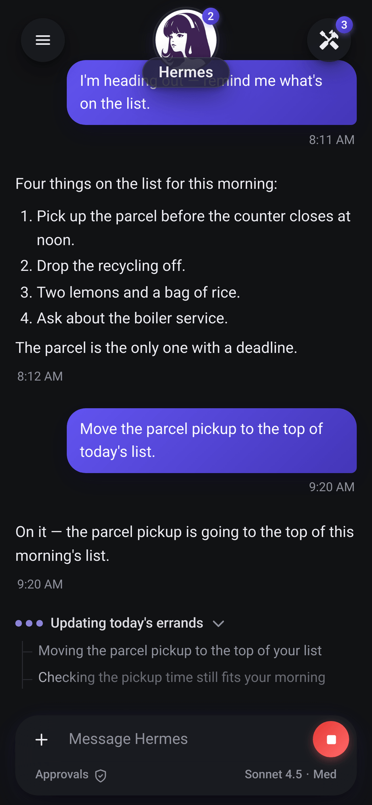</a>
<a href="docs/media/phone-03-chats.png">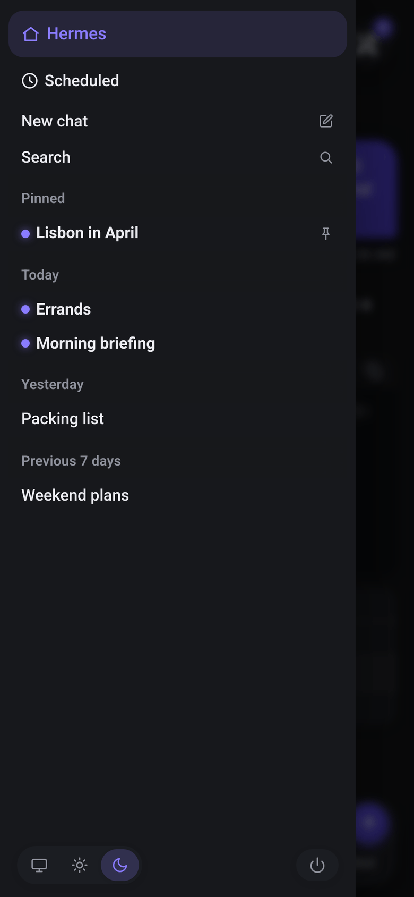</a>
<a href="docs/media/phone-04-inbox.png">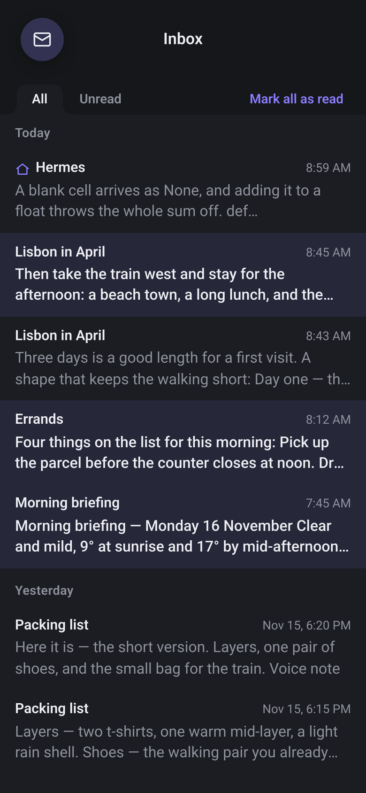</a>
</p>
<p>
<a href="docs/media/phone-05-todo.png">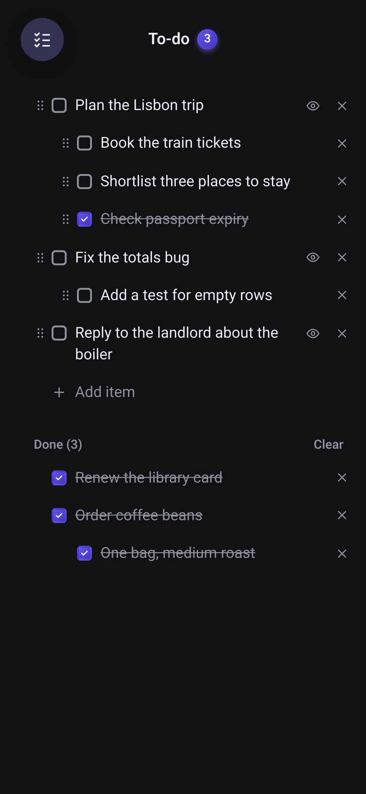</a>
<a href="docs/media/phone-06-schedules.png">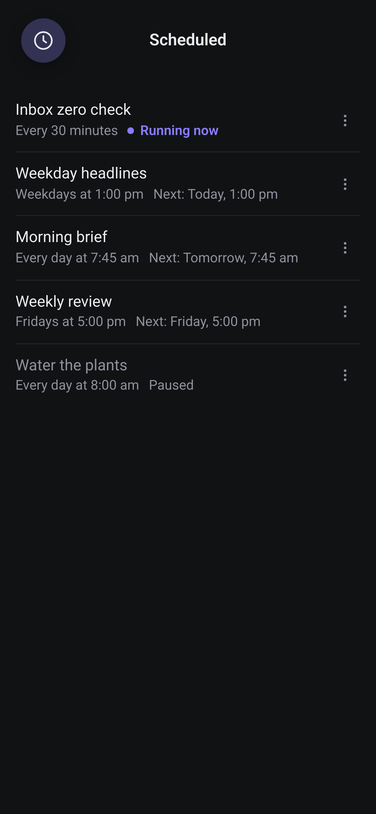</a>
<a href="docs/media/phone-07-models.png">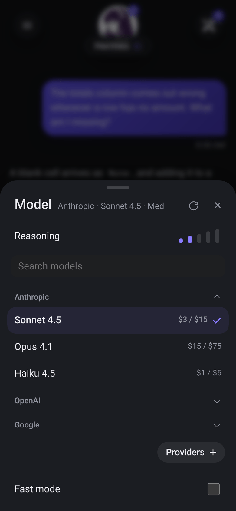</a>
<a href="docs/media/phone-08-menu.png">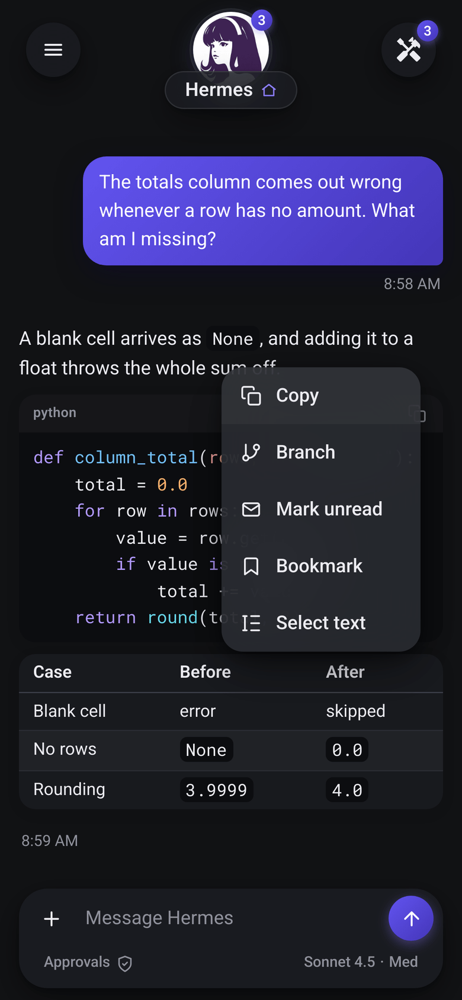</a>
</p>
<p>
<a href="docs/media/phone-09-audio.png">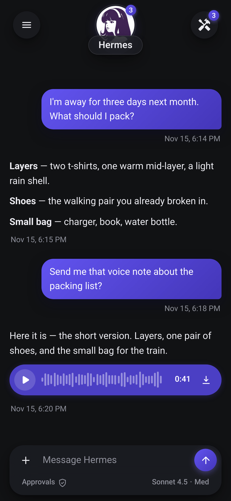</a>
<a href="docs/media/phone-10-light.png">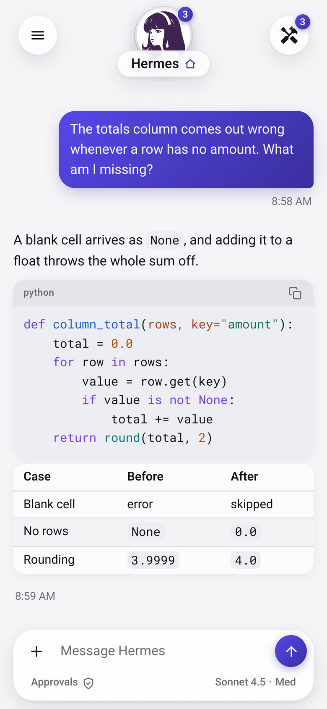</a>
</p>

<p>
<a href="docs/media/desktop-01-computer.png">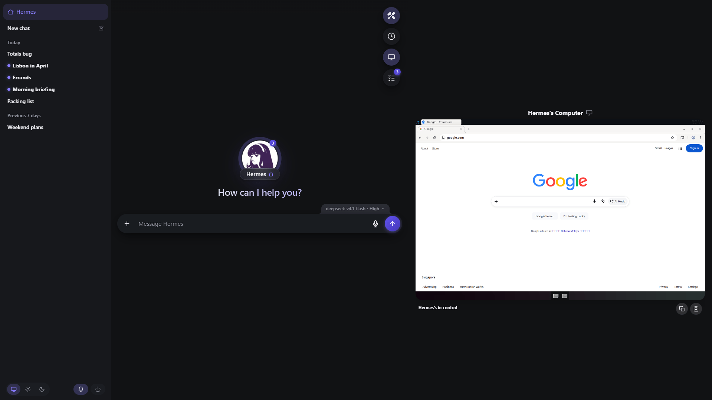</a>
<a href="docs/media/desktop-02-chat.png">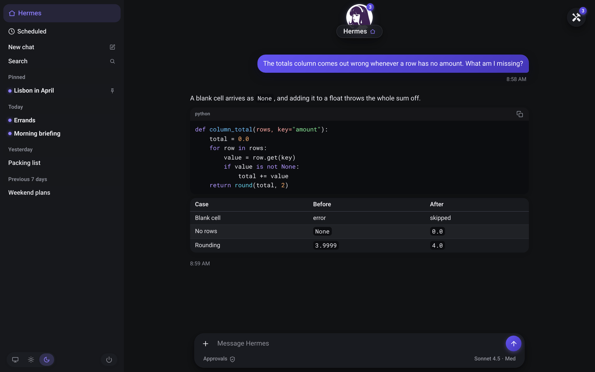</a>
<a href="docs/media/desktop-03-todo.png">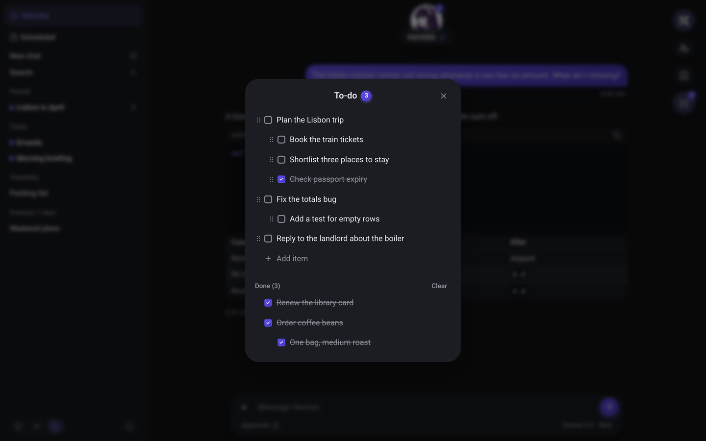</a>
<a href="docs/media/desktop-04-light.png">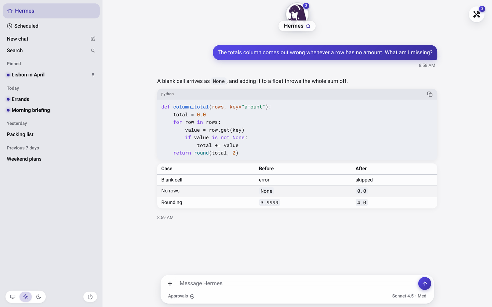</a>
</p>

## Automatic messages

Mini suppresses routine gateway lifecycle notices and first-time command tips delivered through
its bridge. App-only turn instructions discourage unsolicited introductions and profile offers
in existing and new chats. The known legacy introduction is hidden in live replies, history,
inbox and push previews. This is a narrow compatibility filter, not a general classifier of
model-written introductions. Failure templates retain a short explanation without unsupported
slash commands. Original assistant transcripts remain unchanged; filtered bridge deliveries are
not stored. Quoted examples and code are preserved. Other Hermes interfaces are unaffected.

## Requirements

| | |
|---|---|
| Hermes Agent | **v0.23.0** tested (commit `2bd378ed1b8d`). The plugin uses documented plugin, dashboard and state APIs. |
| Python | Whatever Hermes runs (Hermes v0.23.0 ships Python 3.14 here; 3.11+ is expected to work). |
| Browser | A current Chrome, Safari, Firefox or Edge. The app is a plain ES-module page with no build step. Fully tested on Android (Chrome, installed to the home screen) and in Chrome on desktop; **not yet tested on iPhone or iPad** (see [Verified, and not](#verified-and-not)). |
| Optional | `cryptography` + `httpx` for push; `Pillow` for image dimension checks; a Hermes-configured speech-to-text provider for dictation; Hermes' Bot Desktop for the computer view. |

Nothing in this list is installed by the plugin. Optional pieces degrade to a hidden control, never
a broken app.

## Install

The simplest way to install Hermes Mini is to copy this prompt and send it to your Hermes agent:

```text
Install the Hermes Mini plugin for me:
1. Run: hermes plugins install hermes-mini --enable
2. Check that `hermes plugins list` shows hermes-mini as enabled.
3. Tell me the address to open: my dashboard's address followed by
   /dashboard-plugins/hermes-mini/index.html
4. Last, restart the Hermes dashboard and gateway the way they normally
   run on this machine, so the plugin loads. If you're not sure how they
   run, tell me the commands instead of guessing.
```

Hermes asks you to approve the commands. It tells you the address before it restarts anything,
because restarting the gateway ends its reply. Then open the address, sign in with your usual
Hermes login, and use your browser's "Install app" / "Add to Home Screen".

Installing by name uses the Hermes plugin catalog, which pins a reviewed release (currently
v0.4.0). To get the newest commit on `main` before the catalog catches up, install from GitHub
instead:

```bash
hermes plugins install ieatcode4breakfast/hermes-mini --enable
```

Either way, this needs an agent that can run `hermes` commands on the machine Hermes runs on, and
that machine must be able to reach GitHub, where both installs download from. If the agent's
terminal is sandboxed (a Docker or remote terminal backend), or your Hermes install is managed or
read-only, use the manual install below.

### Manual install

Hermes Mini is a directory plugin: `plugin.yaml` plus `register(ctx)` (hooks) plus a
`dashboard/` folder (the app page and its backend routes). Put the folder where Hermes looks for
user plugins and enable it:

```bash
cp -r hermes-mini "$HERMES_HOME/plugins/hermes-mini"
hermes plugins list                  # shows: hermes-mini  not enabled
hermes plugins enable hermes-mini    # shows: enabled
```

`$HERMES_HOME` is your Hermes home (usually `~/.hermes`; a profile home is
`~/.hermes/profiles/<name>`). This install path was verified end to end: a plain directory drop-in
is discovered by Hermes, reported as `not enabled`, then becomes `enabled` and is listed as a `user`
plugin.

Check that Hermes accepts it before enabling:

```bash
hermes plugins doctor "$HERMES_HOME/plugins/hermes-mini" --ci
hermes plugins validate "$HERMES_HOME/plugins/hermes-mini"
```

If your Hermes build supports installing from a local Git checkout, that also works and additionally
records install provenance:

```bash
git clone /path/to/hermes-mini /path/to/hermes-mini.git   # or use your own checkout
hermes plugins install file:///path/to/hermes-mini.git --no-enable
hermes plugins enable hermes-mini
```

This route needs a Git repository, so it does not apply to a plain copied folder (a project
downloaded without a `.git` directory).

Remove it with `hermes plugins remove hermes-mini`, or by deleting the directory. That removes the
code; your settings, picture and app data are left in place (see
[Settings, state and profiles](#settings-state-and-profiles)).

## Open the app

Hermes serves dashboard plugins from the dashboard process. Start it (this is the ordinary Hermes
dashboard, not something Hermes Mini adds):

```bash
hermes dashboard
```

Then open:

```
http://127.0.0.1:9119/dashboard-plugins/hermes-mini/index.html
```

Use `--host`/`--port` if you started the dashboard differently; the path after the origin is fixed
by the plugin's folder name. Hermes' dashboard authentication (its normal session cookie, or an
OAuth/reverse-proxy gate you have configured) protects the page and every `/api/plugins/hermes-mini/`
route. Bookmark it, or use your browser's "Install app" / "Add to Home Screen".

You do not need to open the default dashboard page first. If the dashboard was already running when you enabled the plugin,
restart it (and the gateway, which loads the plugin's hooks) so it picks the plugin up. When the page asks
you to sign in, Hermes' login page brings you back to the app afterwards.

## First run

There is none. Open the app and it is ready to use: the header and composer take the name Hermes
already has for the bot — the default profile's bot title, then the serving profile's, then its
display name or a named profile id, and finally **Hermes**. Nothing asks for a name or picture
first. To change them, open **Edit profile**, the first button in the Tools tray: it saves the new name and picture
in Hermes itself (through its profile methods), so every Hermes client sees them. Hermes's desktop app
keeps its own copy of a picture it has already shown; pick the picture there too to update it.

If Hermes has no model configured yet, there is no reply to show until one is connected from the
model picker on the message box or in Hermes; history, to-dos and the inbox still work.

Reading the page and every capability probe are pure reads. Opening the app may create its own
state files under `$HERMES_HOME/data/hermes-mini/`, and it records the default delivery target once
(see [Settings, state and profiles](#settings-state-and-profiles)).

### Configure a model

Use the model picker at the bottom right of the message box: it lists Hermes's connected providers and their models, lets a
pick switch the chat (and become the default for new chats), and sets the reasoning level and, where
the model supports it, fast mode. **Providers +** lists every provider Hermes supports and saves or
updates an API key through Hermes. A provider that signs in with an account, and a custom endpoint, cannot
be connected from the app: its card says to run `hermes model` on the computer (tap the command to copy
it). Everything goes
through Hermes's own gateway methods, and the app keeps no model state.

You can also use Hermes itself, for example `hermes model` or the dashboard's Config page. See the
[Hermes documentation](https://hermes-agent.nousresearch.com/docs/). Until a model is configured,
there is no reply to show.

## What's in it

- **Chats**: multiple conversations, a main chat, new chat, rename, pin (with a shared manual
  order), delete, reset of the main chat, and a read-only view of a chat that belongs to another
  source. Any chat's `⋮` menu, including the main chat's, offers **Mark unread** / **Mark read**.
  Sending the first message in a New chat promotes it to the main chat when no saved main chat exists yet.
- **Inbox**: every agent message across the app's chats, newest first, with unread tracking. It opens
  from the agent's picture or name, with the unread count on the picture; on a phone it opens as a
  full page. A swipe on a phone or an envelope button on hover marks a message read or
  unread without opening it; a reply's action row in the chat (and its long-press menu) offers Mark unread, which becomes Mark
  read while the reply is held unread, and Bookmark, which becomes Remove bookmark once the reply is kept. The main
  chat's messages carry the same home icon as the chat
  list.
- **To-dos**: one shared list, nesting one level, drag to sort, clear finished, with a live tracked-item
  counter pill beside the **To-do** header. Each active top-level row puts the **Track** / **Untrack** eye
  button and **×** delete button directly on the row (no extra menu): toggling tracking shows a neutral
  *"Tracked"* / *"Untracked"* toast, excludes untracked parents from the To-do header, corner button, and
  folded Tools badge counters, and keeps a dimmed slashed-eye icon visible for untracked items; deleting a
  parent with sub-items asks for confirmation first and removes its sub-items together, while standalone
  items and sub-items delete immediately.
- **Bookmarks**: the agent replies you kept, in the tool directly above To-do in the Tools tray. A reply is bookmarked
  from its action row or its long-press menu; the panel lists them newest bookmark first, each with its chat, time and
  a short preview. Tapping one opens the chat at that reply, and the filled bookmark at the right removes it. Bookmarks
  follow the message: a deleted chat or message simply drops out.
- **Search**: the row directly under New chat in the chats panel. One field looks through the app's chat titles and
  the visible text of your and the agent's messages as you type. A chat hit opens that chat; a message hit opens it at
  that message, with the same Loading message… toast and flash the Inbox uses. Hits from the main chat, both chat and
  message results, carry the home icon. Only what the chat draws is searched: hidden, tool and out-of-scope rows never
  match, and a message compaction carried forward is listed once.
- **Scheduled**: the row under the main chat in the chats panel. It lists the agent's scheduled jobs
  (Hermes cron), each with what it is, when it runs in plain words and when it runs next; a job
  running now says so, and a failed last run says "Last run didn't finish". Each row's ⋮ menu pauses,
  resumes or deletes the job through Hermes' own routes, or adds it to the message being written as an
  inline pill, which reaches the agent as `[Schedule: <name> · job <id>]`.
- **Skills and schedules with "/"**: typing `/` at the start of a word in the message box lists the agent's skills
  (bolt icon) and schedules (clock icon) above it; typing on narrows the list. A pick goes into the message as the same
  inline pill. A message with skills is sent through Hermes's own skill command (`command.dispatch`), so each skill's
  instructions load with your words, up to five at once; the chat shows the skill pills and your words, never the
  expanded skill text. Skills go with a new message, not a steer: while a reply runs, a draft with a skill pill
  shows Stop instead of Send.
- **Tools tray**: the hammer-and-screwdriver button folds the Edit profile, Computer, Bookmarks and To-do buttons away under
  it and brings them back; folded is the default, remembered per device. On a computer, while
  the computer view is open, its button stays out under Tools even when the tray is folded.
- **Model and provider picker**: a two-row message card keeps the `+` button, input field, dictation, and Send on
  the top row, and places a transparent control bar underneath inside the card. Aligned at the bottom right sits
  the model picker showing the chat's model and reasoning level. Friendly names are used throughout — the
  button, sheet, and picker read "DeepSeek v4.1 Flash" instead of the raw model id.
  The sheet header shows the active provider name along with the model and reasoning level. It lists providers
  Hermes recognizes as explicitly configured and their models (search, prices where Hermes has them), with a
  five-bar reasoning level meter and fast mode where the model supports it; a pick switches the current chat
  and updates the default for future new chats without changing other existing chats, and new chats show the
  default reasoning level immediately before sending. Model, provider, dictation, and drawer errors appear as
  compact toasts with **Details** and stay until dismissed with **×**.
  Before switching, the picker explains unusually high model prices, the cost of rereading a long chat, or the
  limits of Hermes 3 or 4 chat models when relevant. **Providers +** can add or update a provider’s
  API key when Hermes identifies it as an API-key provider, including replacement after connection. Other providers
  show setup instructions for Hermes. A new chat waits for model confirmation before sending its first message. Dictation errors appear in dismissible toasts too. On the bottom
  left of that same bar sits the **Approval mode** button showing neutral **`Approvals`** text followed by a
  status shield icon (turning the icon red without any resting background fill when **Off**): tapping it opens a
  bottom sheet for Hermes's live profile approval mode (**Manual**, **Smart**, **Off**) with plain-English
  descriptions. It asks for confirmation before switching to **Off** (explicit deny rules in Hermes
  still apply), shows a red *"Approvals off"* toast (or green when enabled), and writes Hermes's profile config
  (`approvals.mode`) through Hermes's gateway (`config.set`).
- **Live streaming**: replies appear as they arrive, with collapsible per-subject activity trees above each
  reply showing live thinking dots beside the active header, shimmer-highlighted active steps, inline thumbnails
  for checked or generated pictures, clickable links for web pages opened during each step, and automatic recovery
  across reloads and disconnects. Narration uses Hermes' auxiliary model slots and stays silent if that is not
  configured.
- **Steering**: send while a reply is running to steer the current turn.
- **Approvals and questions**: answer them in the app; an approval can also be approved or denied
  from its notification. A set of questions goes one at a time: Skip skips just that question, Back
  reopens the one before, and a review step lists every answer with Change before you Submit. A "pick any
  that apply" question takes several answers. When the agent connects an app (Notion, Slack, ...), a card
  offers the sign-in link and Skip. Inline prompt cards also handle sudo passwords, skill secrets, vault
  unlocks, and saved logins with masked inputs (Show/Hide), plus one-time codes, all with Skip. A question's answer
  box has its own mic: tap to dictate an answer through the same speech-to-text as the input box, then
  edit or send it.
- **Attachments**: photos, files and pasted text, with a collapsed view for long pastes. Pictures the
  agent sends with `MEDIA:` show inline; audio plays inline in a voice-note player (play/pause, a
  waveform to tap or drag, download; the waveform needs ffmpeg, on PATH or in Hermes' tools
  directory); other files arrive as cards that download only when tapped. A picture that cannot be
  loaded (a missing file, a dead web link) shows its alt text instead.
- **Share from Android**: the installed app is listed in Android's share sheet. Sharing text, a link, pictures or
  files to it opens the app with the words in the message box and the pictures and files attached (up to 10), in the
  chat on screen, ready to add a word and send. The share stays on the phone (the service worker keeps it until the app
  takes it, at most an hour) and nothing is sent until you press Send. An app installed before this needs Chrome to
  pick up the new manifest, which it does on its own within about a day; uninstalling and adding it to the home screen
  again does it at once.
- **Picture viewer**: full screen, with a back button and a download button; swipe, the arrows or
  the arrow keys slide between a message's pictures; pinch or double-tap to zoom.
- **Markdown**: GitHub-flavoured markdown with sanitised HTML and syntax highlighting.
- **Edit and branch**: edit and resend your message, or branch a conversation.
- **Dictation**: record and insert at the caret, with the spaces a keyboard would add, through whatever
  speech-to-text provider Hermes is configured to use.
- **Notifications** (optional): Web Push for approvals, questions and finished replies, with
  per-chat mute. A notification stays until it is tapped or swiped away.
- **Scheduled job results**: Hermes cron output can be posted into the main chat or a chosen side
  chat, with a push.
- **Computer** (optional): a phone-friendly live view of your agent's desktop, with take-over,
  hand-back, a trackpad and clipboard, gated by Hermes' own display tickets and control lease.

## Optional features and how they degrade

| Feature | Needs | Without it |
|---|---|---|
| Dictation | An STT provider configured in Hermes; a browser that can record. | The microphone is hidden. The `/dictate` route also answers with a clear message. |
| Notifications | `cryptography` and `httpx` importable by Hermes, a browser with Push, and your click on the bell. | The bell is hidden. Chat is unaffected. |
| Computer | Hermes' Bot Desktop supported and installed on this host (`tools.bot_desktop`). | The computer button is hidden. Chat and to-dos still work. |
| Live narration | A Hermes auxiliary model (Hermes' `title_generation` inheritance). | The narration line is simply absent. |

A failed capability probe makes the app keep the control visible rather than hide something that
might work. The server always enforces the real rule: a disabled feature returns an error, it does
not quietly succeed.

## What it touches

Hermes Mini is a community plugin, not a Nous Research product. Everything it does goes through Hermes'
plugin surfaces; this is the full list of what it reads, writes, runs and sends.

**Serves**
- A web app from your Hermes dashboard: static files under `/dashboard-plugins/hermes-mini/` and routes
  under `/api/plugins/hermes-mini/`, behind the dashboard's own login. It opens no port of its own.
- A chat platform named `hermes-mini` inside the gateway (in-process), so scheduled jobs can deliver
  their results to the app.

**Hooks (app chats only; other chats, Discord, the CLI and cron runs are left alone; subagents of app chats inherit the turn rule and self-edit guard, while push notifications skip them)**
- `pre_llm_call`: adds a short turn rule to app chats (acknowledge the newest message before the first
  tool call) and the default delivery target for scheduled jobs created there.
- `post_llm_call`, `pre_approval_request`, `on_human_input_request`: queue a push notification for a
  finished reply, an approval waiting for you, or a question the agent asks — only when you have turned
  notifications on.
- `pre_tool_call`: blocks an app chat from editing the plugin's own files (a self-edit guard).

**Reads**
- Hermes' chat history and session list (through Hermes' storage interface `persistence_assembly`, with
  `SessionDB` fallback on Hermes 0.23.0–0.23.2; the Inbox and Search queries open `state.db` read-only), the
  scheduled-job list
  (Hermes' cron routes), the skill list (Hermes' `/api/skills` route), the model/provider list, and its own data folder.

**Writes**
- Its own settings in `$HERMES_HOME/hermes-mini/` and state in `$HERMES_HOME/data/hermes-mini/`.
- `$HERMES_HOME/config.yaml`, once automatically, through Hermes' config API: it records
  `platforms.hermes-mini.home_channel` (`chat_id: "main"`, resolved through the app registry) when none
  is set (and marks the platform enabled if it has no `enabled` key). Nothing else there automatically.
- Through Hermes' own gateway methods, only when you explicitly use those UI controls: profile name and
  picture (`profiles.configure` / `profiles.set_asset`) in Edit profile, provider API keys in
  **Providers +**, and `approvals.mode` (`config.set`) in the approval-mode sheet.
- Through Hermes' storage interface (`persistence_assembly`, or `SessionDB.append_message` on Hermes
  0.23.0–0.23.2): appends a message row to `state.db` when a scheduled job delivers to `hermes-mini`.
- `$HERMES_HOME/logs/gateway-restart-app.log` when you press the **Restart** button.

**Runs**
- `ffmpeg` (from PATH or Hermes' tools folder) to read the length and waveform of an audio attachment.
- The **Restart** button runs `hermes gateway restart -y --detach` and then restarts the dashboard, as the same user,
  only when you press it (at most once a minute).
- With the optional computer view: a short Python helper (Tk) to copy text out of the desktop, and `xclip`
  to paste a picture into it.

**Model calls**
- The live narration line is written by Hermes' auxiliary model (the same slot Hermes uses for chat
  titles), with a short prompt built from the tool steps of the current turn — a few small calls per turn,
  at most 80 tokens each, on your provider and your bill. Without an auxiliary model the line is absent.

**Sends over the network**
- Web Push messages to your browser's push service (Google FCM, Mozilla, Apple or Windows), only after you turn
  notifications on, and only to those hosts. The push key is created at that moment.
- Dictation audio to the speech-to-text provider you configured in Hermes (through Hermes).
- Nothing else: no telemetry, no analytics, no update checks.

## Settings, state and profiles

The plugin directory is replaceable code. Everything you change lives outside it, under the Hermes
home of the profile serving the request, resolved with Hermes' own helper at request time:

| Path | Contents |
|---|---|
| `$HERMES_HOME/hermes-mini/config.yaml` | Optional public URL and push contact, plus legacy/optional app-local identity fields (the current Edit profile saves name and picture in Hermes' own profile). |
| `$HERMES_HOME/hermes-mini/assets/` | Legacy/optional app-uploaded picture (the current Edit profile saves to Hermes' own profile assets). |
| `$HERMES_HOME/data/hermes-mini/` | App state: to-dos, pin order, seen/unread markers, inbox read state, bookmarks, activity trees (`activity.json`), gateway restart events, the app-chat registry and recorded main-chat id, push key, subscriptions and muted chats. |

`config.yaml` is written atomically with mode `0600`, and unknown keys are dropped. App settings and
state are strictly per profile and never cross profiles: a second Hermes profile gets its own settings
and data, and one profile's app never reads another's. The agent's name and picture are the one
deliberate exception: they check the default profile first, matching how the name is chosen elsewhere.

The plugin also records the platform's delivery default in Hermes' own `$HERMES_HOME/config.yaml`:
`platforms.hermes-mini.home_channel` with `chat_id: "main"` (resolved to the real main-chat id through
`app-chats.json`), and in that same first write it marks the platform enabled if
it has no `enabled` key. The app records its main chat there the first time it loads, so a bare
`hermes-mini` job address has a destination. The home channel is written only when no value is
present; an existing value is never replaced.

The app's own registry, `$HERMES_HOME/data/hermes-mini/app-chats.json`, also records the main chat's
id. That id, not the chat's name, is how the app and scheduled-job delivery find the home.

Every app chat carries a built-in turn rule: acknowledge the newest message and say in one line
what happens next before starting work. It rides along with every user message **in an app chat
only** (and its subagents), never in Discord, cron, or another channel.

The plugin also contributes two system-prompt sections to app chats only: `hermes-mini.app`
describes the app, its chats, scheduled-job delivery and image handling; `hermes-mini.style` keeps
replies plain — the point first, no code or file paths, no jargon unless explicitly asked. Other
surfaces — Discord, cron, the terminal — never receive them.

An optional file at `$HERMES_HOME/data/hermes-mini/app-instructions.md` is appended to that rule.
Use it for extra operator instructions; the built-in acknowledgement stays.

## Push notifications

Turning notifications on is the only thing that creates the VAPID key pair, and it happens the first
time you press the bell and confirm. The key and your subscription stay in
`$HERMES_HOME/data/hermes-mini/push/`. Only known push services (FCM, Mozilla, Apple, Windows) are
accepted as subscription endpoints, and the request must be HTTPS.

The VAPID `sub` claim uses, in order: your configured push contact, your configured public URL,
Hermes' configured dashboard/gateway public URL, then a reserved `.invalid` fallback. No personal
domain is baked into the source.

A notification stays until it is tapped or swiped away. Reading its chat in the app does not close
it: on many Android launchers an app closing its own notification leaves the icon's count behind,
and a web app cannot correct that count.

## Scheduled job results

A Hermes scheduled job can post its result into the app. Address it as:

- `hermes-mini:main` — the main chat.
- `hermes-mini:<chat id>` — a specific chat, stable across renames.
- `hermes-mini:<chat name>` — a named chat, when the name is unique. The spelling's case does not
  matter.
- `hermes-mini` — the same as `hermes-mini:main`.

`main` and `home` are reserved words for the main chat, so a side chat with either name is reached
by its id, not its name.

The result is stored as a normal message in that chat and pushes a notification. The plugin gives
the app a default delivery chat the first time it loads, so no setup is needed. The home itself is
recorded by id in the app registry: renaming another chat to `Hermes Mini` cannot take it, and
resetting the main chat records the replacement id.

A name is a label, not an identity. If the named chat is missing, renamed, archived, or matches
more than one chat, the result goes to the main chat. The app does not announce the move; the
plugin's log records it. For a recurring job, or one that must keep working if a chat is renamed,
use the chat's id.

## Computer view

The viewer is built into this plugin (`dashboard/computer/`), including its noVNC runtime under
`dashboard/computer/vendor/novnc/`. It loads only when you first tap the computer button; the app
shell and its service worker install without it. The viewer uses Hermes' own `/api/display/ws`
(display tickets and control leases) and the plugin's `/api/plugins/hermes-mini/computer/clipboard`
routes, which are limited to the person currently holding control.

Hermes Mini does not install desktop packages or run a desktop in the background. If Bot Desktop is
not set up, the button is hidden; when it is, **Start Screen** asks Hermes to start one.

## Troubleshooting

- **The page 404s.** The dashboard must be the process serving it, and the folder must be named
  `hermes-mini`. Check `hermes plugins list` and that `dashboard/manifest.json` is present.
- **Everything 401s or redirects to a login.** That is Hermes' dashboard auth; sign in through the
  dashboard first.
- **"Not connected yet".** The WebSocket to the Hermes gateway is down. Check the gateway is running;
  the app retries on its own.
- **No microphone.** No STT provider is configured, or the browser cannot record. Configure STT in
  Hermes (see the Hermes docs), then reload.
- **No bell.** `cryptography`/`httpx` are missing from Hermes' environment, or the browser does not
  support Push.
- **No computer button.** Bot Desktop is unsupported or not installed on this host.
- **The name is `Hermes`.** No name, display name or named profile exists yet. Open Tools → Edit profile
  to set one, or set it in Hermes.

## Verified, and not

Tested here against the real Hermes runtime: the plugin loads through Hermes' discovery and
`register(ctx)`; the manifest passes `hermes plugins doctor` and `hermes plugins validate`; the app
routes the suite exercises; settings/identity/avatar validation; push key opt-in and endpoint gating;
dictation delegation to Hermes' provider with a mocked provider; the app-chat scoping and the
self-edit guard; scheduled-job target resolution across ids, names, archived chats and missing
chats; search across chat titles and message text (against a mock state.db, with and without
message_fts, compaction included); the browser module graph and service-worker asset list.

Phones and desktop: the app has been used and fully tested on Android (Chrome, installed to the home screen) and in
Chrome on desktop. It has **not been tested on an iPhone or iPad**. It is built on standard web features Safari supports, but
expect rough edges there. Known differences: notifications need iOS 16.4 or later and the app added to
the Home Screen; approval notifications have no Approve/Deny buttons (iOS does not show them; answer
in the app); there is no vibration on swipes; dictation records in a different audio format (mp4)
whose transcription is untested; and Ogg/Opus audio falls back to the download card if Safari cannot
play it. Reports from iPhone users are welcome.

Not verified here, and worth trying yourself: a real desktop session through Bot Desktop, a real push
delivery to a device, a real speech-to-text transcription, a live scheduled-job delivery, and the
app's appearance in a specific browser. Those require services and credentials this project does not
ship. See
[CHANGELOG.md](CHANGELOG.md) for the honest status list.

## Documentation

- [AGENTS.md](AGENTS.md) — contributor constraints (plugin only, no core edits, external state).
- [CONTRIBUTING.md](CONTRIBUTING.md) — how to run the tests and what a change should include.
- [SECURITY.md](SECURITY.md) — how to report a vulnerability.
- [THIRD_PARTY_NOTICES.md](THIRD_PARTY_NOTICES.md) — bundled libraries and their licenses.
- [CHANGELOG.md](CHANGELOG.md) — status and history.

## License

MIT for the original project code; see [LICENSE](LICENSE). Bundled third-party code keeps its own
license — see [THIRD_PARTY_NOTICES.md](THIRD_PARTY_NOTICES.md).
